# MxSheet Demo

> Example Mendix module for the [MxSheet](https://github.com/bharathidas/MxSheet) spreadsheet widget: ten working
> pages over seeded data that show how to configure the widget for editing, budgeting, analysis, models, reports,
> teamwork, automation and governance.

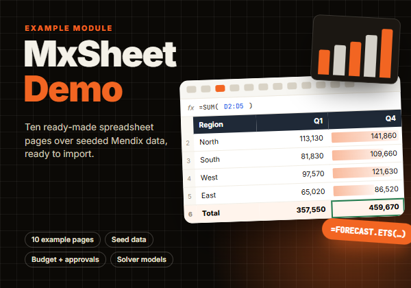

- Mendix Studio Pro 11.12.1 or newer, web only
- MxSheet widget 1.0.0 (bundled in the module package)
- Needs only Atlas Core (`Atlas_Core.Atlas_Default` and `Atlas_Core.PopupLayout`); no Java actions, no jar files
- License: Apache-2.0

## Installation

1. Download `MxSheetDemo.mpk` from the [latest release](https://github.com/bharathidas/MxSheetDemo/releases/latest)
   (or the Mendix Marketplace) and import it with **App > Import module package**.
2. The MxSheet widget comes with the package. If your `widgets` folder already has a newer version, keep the newer
   one. Press F4 if the toolbox does not show MxSheet yet.
3. Under **App > Security > User roles**, add `MxSheetDemo.User` to the roles that should see the pages.
4. Add `MxSheetDemo.Sheet_Showcase` to the navigation. It links to the other pages.
5. Run the app. Each page creates its example workbook the first time it opens; **Restore example sheets** puts it
   back.

## What is inside

| Document | Purpose |
| --- | --- |
| Entity `SheetOrder` | Example orders for the data sheet: number, customer, quantity, price, shipped, due date, status, stock |
| Entity `SheetWorkbook` | One per page: workbook JSON, versions, restrictions, roles, and the MX.CALL arguments and result |
| Entities `SheetAccount`, `SheetPerson` | Lookup columns over associations |
| Entity `SheetTemplate` | Sheet templates users save and reuse |
| Entity `SheetAudit` | Audit trail of changes, exports, mentions and approvals |
| Page `Sheet_Showcase` | Overview with the main features and links to every page |
| Pages `Sheet_EditData`, `Sheet_Budget`, `Sheet_Analysis`, `Sheet_Models`, `Sheet_Reports`, `Sheet_Teamwork`, `Sheet_Automation`, `Sheet_Governance`, `Sheet_WhatsNew4` | The use-case pages |
| Page `SheetOrder_Edit` | Popup the data sheet opens for a row (On open row) |
| `DS_Sheet_*`, `ACT_Reset_Sheet_*` | Create and reset each page's workbook |
| `ACT_SeedOrders`, `ACT_ClearOrders`, `ACT_NewOrder`, `ACT_OrderChanged` | Example data and data sheet actions |
| `ACT_SaveTemplate`, `ACT_SyncWorkbook` | Save as template and live sync |
| `ACT_Log*` | Audit records for changes, exports, server exports, mentions, submit, approve and reject |
| `ACT_Preset_Viewer`, `ACT_Preset_Analyst`, `ACT_Preset_Admin` | Governance presets for restrictions and roles |
| `FN_TaxRate`, `FN_OrderQty` | Microflows called from formulas with `MX.CALL` |
| Module role `User` | Access to all pages and entities |

The source of the module lives in the Mendix model; this repository has the module package, its theme styles, the
cover and the screenshots.

## Screenshots

| | |
| --- | --- |
| 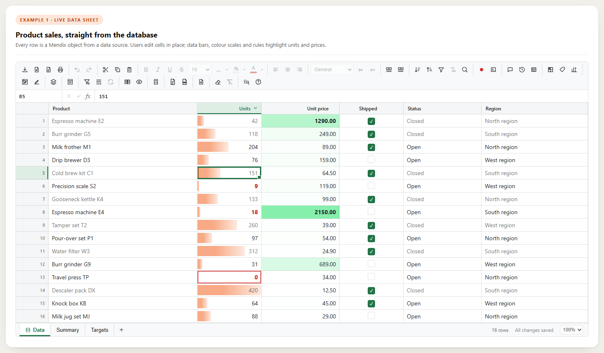 | 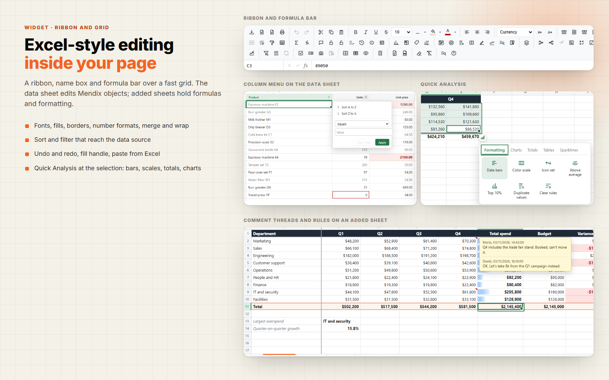 |
| 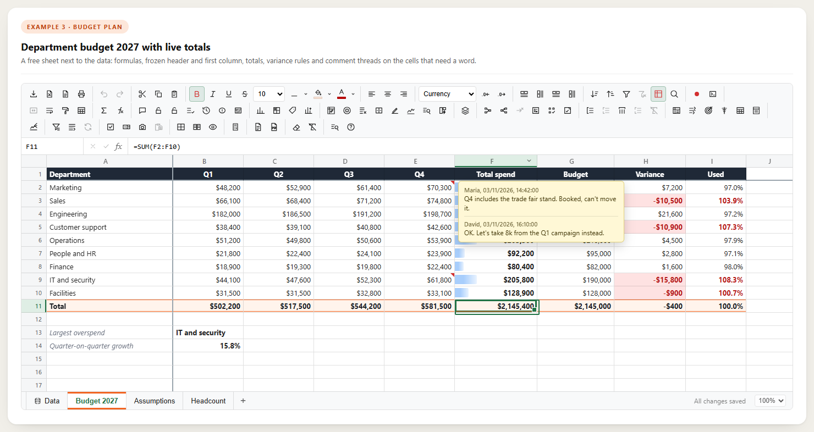 | 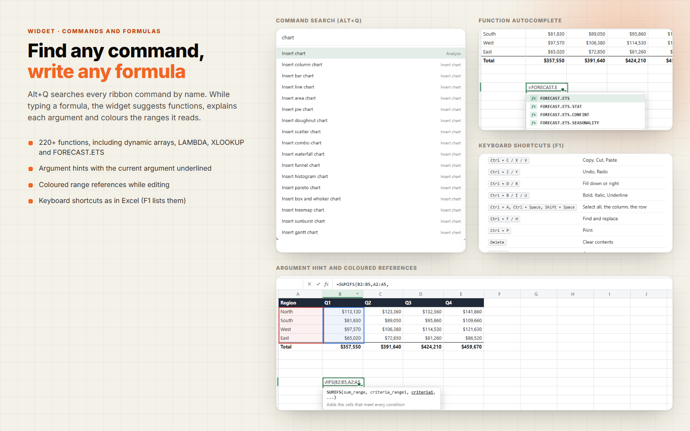 |
| 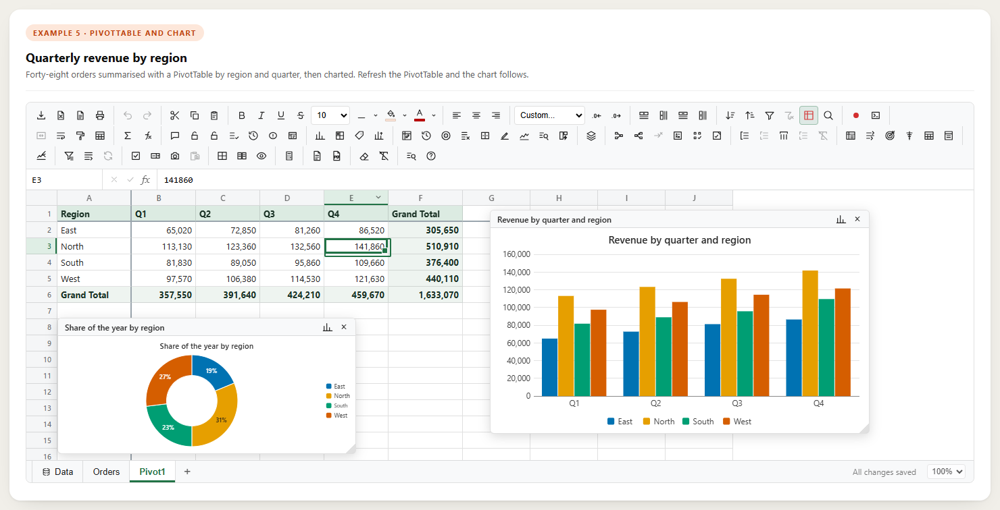 | 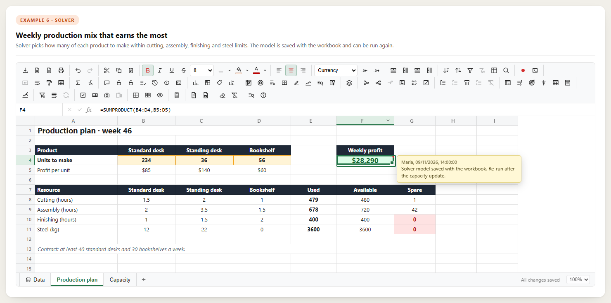 |
| 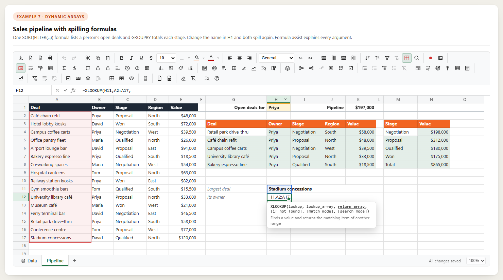 | 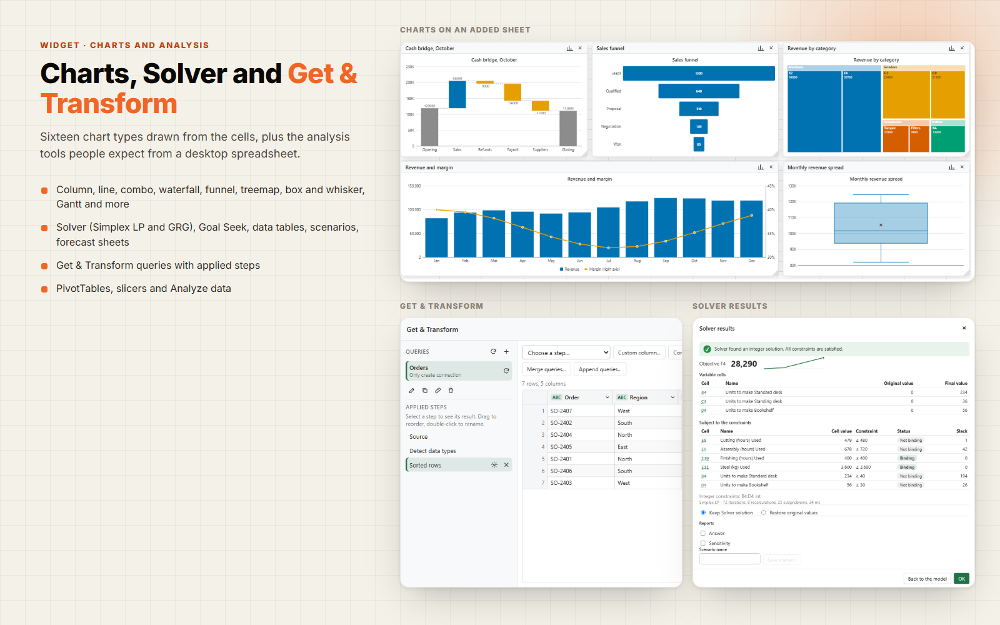 |
| 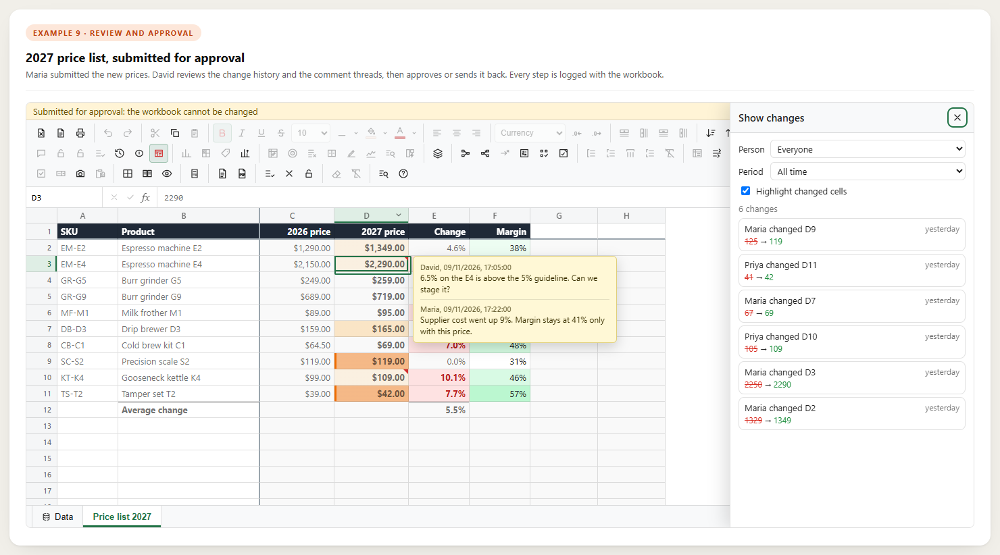 | 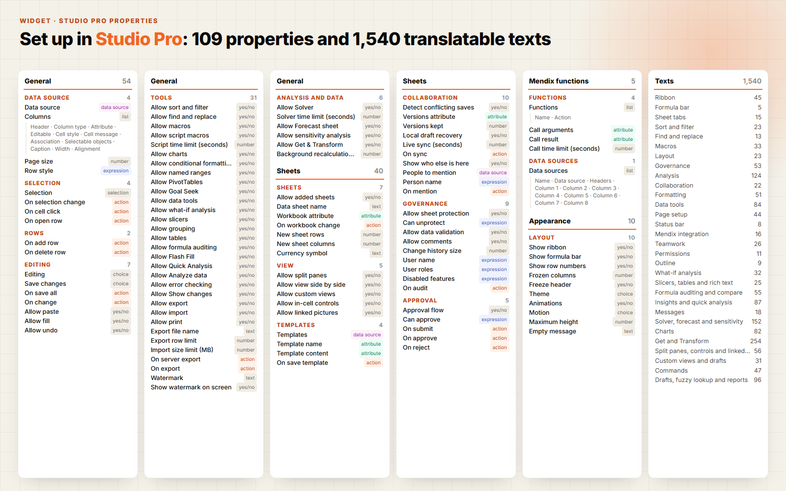 |

## License

Apache-2.0 © MX Techies 2026
